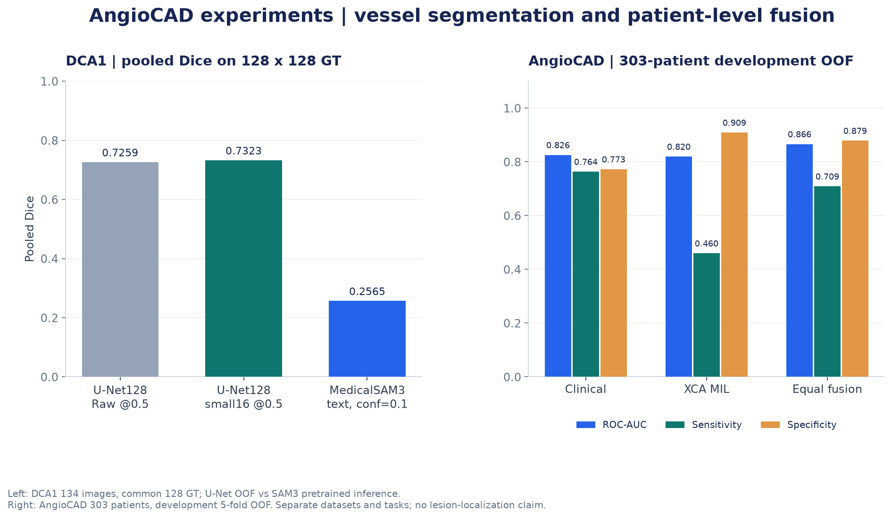

# 관상동맥조영술 영상 분석: 분할에서 환자 단위 Fusion까지

관상동맥조영술(XCA) 영상을 분석하면서, 혈관을 잘 나누는 것과 협착을 잘 분류하는 것이 서로 다른 문제라는 점을 살펴본 개인 실험입니다. 데이터의 환자·series·라벨을 먼저 점검하고, DCA1의 U-Net 혈관 분할에서 AngioCAD 분류와 임상 정보 결합으로 실험을 넓혔습니다.

팀 관상동맥 AI 프로젝트 중 제가 직접 진행한 `hyunkyung/`의 영상·임상 실험을 정리했습니다. 팀 전체의 3D CT 분석이나 다른 팀원의 구현을 포함하지 않았습니다. 아래 수치는 당시 노트북에 저장된 결과이며, 이 공개용 사본에서 새로 학습한 결과는 아닙니다.



왼쪽은 DCA1의 혈관 분할, 오른쪽은 AngioCAD의 환자 분류 결과입니다. 서로 다른 데이터와 과제를 한 성능으로 합치지 않았습니다.

## 데이터 출처

- **AngioCAD:** [공식 데이터](https://doi.org/10.5281/zenodo.15826856), [원 논문](https://doi.org/10.1016/j.cmpb.2026.109368). 논문의 공식 배포·비식별화 설명을 확인했으나 개별 Zenodo 레코드의 정확한 라이선스는 추가 확인이 필요합니다.
- **DCA1:** 원본 노트북에 기록된 [영상·GT 배포 경로](http://personal.cimat.mx:8181/~ivan.cruz/DB_Angiograms_files/DB_Angiograms_134.zip). 영상134개와 GT134개를 사용했습니다. 정확한 라이선스는 확인되지 않았습니다.

이 저장소에는 원본 의료영상, GT·예측 mask, crop, overlay, 환자별 임상표를 포함하지 않았습니다. 그림은 집계 수치로 다시 그렸습니다. AngioCAD Clinical-only는 이 데이터셋의 임상정보를 사용한 실험으로, 별도 UCI Clinical RF 프로젝트와 다릅니다. 모델 가중치와 데이터의 이용 조건은 [출처·이용 조건](docs/data_sources.md)에 구분했습니다.

## 1. 모델보다 먼저 확인한 데이터

영상 폴더413개가 모두 같은 조건의 학습 자료는 아니었습니다. 전체121,566프레임에서 비표준 크기, 짧거나 긴 series, 라벨의 역순 범위, 임상정보 누락을 확인했습니다. Pixel hash로 환자 간 중복을 검사하고, 제외 기준과 정제 규칙을 기록했습니다.

모델용 cohort를 정리한 뒤 영상 보유412명을 Development329명과 Test83명으로 분리했습니다. 같은 환자의 frame이 양쪽에 들어가지 않도록 환자 split을 series와 frame에 연결했고, Development에는5-fold를 부여했습니다. 임상정보와 영상이 함께 있는 개발 환자는303명입니다.

전처리는 원본3채널 복제, 원본과 서로 다른 CLAHE 결과의 조합, CLAHE3채널 복제를 비교할 수 있도록 구성했습니다. 코드와 단계별 파일은 [실험 흐름](docs/experiments.md)에 정리했습니다.

## 2. DCA1 혈관 분할: Raw와 후처리를 나눠 보기

DCA1은 픽셀GT가 있어 분할 모델을 정량 평가할 수 있었습니다. 작은 표본의 overfit으로 학습 구현을 먼저 확인한 뒤, 이미지 단위5-fold OOF를 만들었습니다. 환자ID가 없어 환자 단위 분할을 보장할 수 없다는 한계도 있습니다.

| 실험 | 평가 조건 | Pooled Dice |
|---|---|---:|
| U-Net128 Raw | 128×128 GT, threshold0.5 | 0.725928 |
| U-Net128 + 작은 component 제거 | 같은128 GT, 16px미만 제거 | 0.732256 |
| U-Net256 Raw | 256×256 GT, threshold0.5 | 0.709043 |
| MedicalSAM3 fixed text | 같은128 GT, `coronary artery`, confidence0.1 | 0.256543 |

[원본 근거 셀과 집계 CSV](results/README.md)

작은 component 제거는 평균을 높였지만 일부 영상에서는 혈관도 사라졌습니다. Hough로 catheter를 제거하는 방법은 한 사례의 Dice를 크게 떨어뜨려 채택하지 않았습니다. 후처리 정책을 같은 OOF에서 선택했으므로 독립 Test 개선으로 해석하지 않았습니다.

256입력은 축소 과정의 연결성을 더 잘 보존했지만 이 실행의 OOF 성능은128보다 낮았습니다. 두 결과는 각 해상도별GT에서 계산했으며 학습 이력도 달라, 해상도 하나만의 효과라고 단정할 수 없습니다.

## 3. AngioCAD 적용과 MedicalSAM의 한계

DCA1에서 학습한 U-Net128 모델5개를 AngioCAD의12series·36frame에 적용했습니다. AngioCAD에는 분할 픽셀GT가 없어 정성 사례로만 다뤘습니다. 위 표의 DCA1 Dice를 AngioCAD 성능으로 옮겨 쓰지 않았습니다.

MedicalSAM3의 DCA1 GT-box 진단에서는 native macro mean Dice0.710780이 나왔지만, 정답에서 만든 위치 정보를 사용한 결과입니다. 자동 Text Prompt의128 pooled Dice와 평가 조건이 다릅니다. [Prompt 진단 그래프](figures/sam3_prompt_diagnostics.png)

GPT-4o·Qwen2.5-VL로 text/box를 생성하는 실험도 진행했습니다. 유효한 JSON이나 비어 있지 않은 mask가 해부학적 정확성을 보장하지는 않았습니다. LCX 사례의 수동 평가가 남아 있고, 서로 다른 혈관 이름이 거의 같은 mask를 반환하기도 했습니다. MedSAM2 코드에 CA-SAM2 가중치를 연결한 단일 사례에서도 후보mask 모두 positive point를 포함하지 않는 문제가 남았습니다.

## 4. 협착 분류와 Grad-CAM

ResNet50으로15분절의7등급과 view-level over50을 예측했습니다. 7등급의 VAL QWK는0.352706, balanced accuracy는0.273112였습니다. 라벨을3-bin으로 줄이고 학습 설정도 바꾼 후 QWK0.389810, balanced accuracy0.502628을 얻었지만 over50 AUROC는0.819144에서0.806758로 낮아졌습니다. 이 실험의 최종 Test 출력은 없습니다.

별도70/15/15 환자 split에서는 ResNet18로 Prox LCX/LAD의 NL 대 abnormal을 학습했습니다. Test62명의 환자 평균 확률 AUROC는 각각0.718954와0.639254였습니다. [분류 결과](figures/prox_classification.png)

Grad-CAM과 threshold 기반 pseudo-mask는 모델이 어디를 보는지 살펴보는 자료였습니다. 병변 위치GT에 대한 평가는 없어 협착 부위를 정확히 탐지하거나 분할했다고 주장하지 않습니다.

## 5. Clinical과 XCA를 결합했을 때의 변화

AngioCAD 개발303명에서 Clinical AdaBoost와 XCA ResNet50 attention MIL의 환자 단위5-fold OOF를 만들고 확률을1:1로 평균했습니다. Target은 `any_definite_over_50`, threshold는0.5입니다.

| 모델 | ROC-AUC | Sensitivity | Specificity | Accuracy |
|---|---:|---:|---:|---:|
| Clinical-only | 0.8257 | 0.7637 | 0.7727 | 0.7657 |
| XCA-only MIL | 0.8197 | 0.4599 | 0.9091 | 0.5578 |
| Equal late fusion | 0.8662 | 0.7089 | 0.8788 | 0.7459 |


Fusion은 AUROC와 특이도를 높였지만 Clinical-only보다 민감도와 정확도는 낮았습니다. 환자 단위 paired bootstrap의 AUROC차이는+0.0405, 95% CI는[+0.0169,+0.0657]이었고, 민감도 차이는−0.0549였습니다. ‘모달리티를 더하면 모두 좋아진다’보다, 선별 목적에서 무엇을 놓치고 무엇을 얻는지 판단해야 했습니다. 별도 Test와 외부 검증은 남아 있습니다.

## 배운 점과 남은 과제

영상의 연결성, mask 생성률, 분류 점수, 병변 위치의 정확성은 각각 확인해야 했습니다. 평균 지표가 올라가도 특정 혈관을 지우는 후처리는 채택하기 어려웠고, 높은 mLLM confidence도 해부학적 정답을 대신하지 못했습니다.

현재 남은 과제는 분할GT가 있는 AngioCAD 평가, mLLM 사례의 수동·다환자 평가, 입력과 저장 경로가 어긋난 사례 기록 정리, point 미포함 원인 확인, 고정 모델의 Test·외부 검증입니다. 실패와 미완료 범위는 [실험 문서](docs/experiments.md)에 남겼습니다.

## 파일과 실행

- `notebooks/`: 개인 원본13개에서 저장 출력·개인 경로·사례 식별값을 정리한 사본
- `results/`: 원본 셀에 연결한 집계 CSV와 평가 조건
- `figures/`: 의료영상 없는 집계 그래프
- `scripts/`: 집계 그래프 재생성과 공개 파일 정적 검사

```bash
python -m pip install -r requirements.txt
python scripts/plot_results.py
python scripts/review_public_files.py
```

위 명령은 모델을 학습하거나 외부 API를 호출하지 않습니다. 원래 노트북에는 권한이 있는 데이터·가중치·GPU·선행 산출물이 필요하며, 공개용 사본의 전체 재실행은 확인하지 않았습니다. [실행 환경](docs/environment.md), [원본 대비 변경](docs/source_changes.md), [공개 범위](docs/publication_review.md), [포트폴리오 카드](docs/portfolio_card.md)
