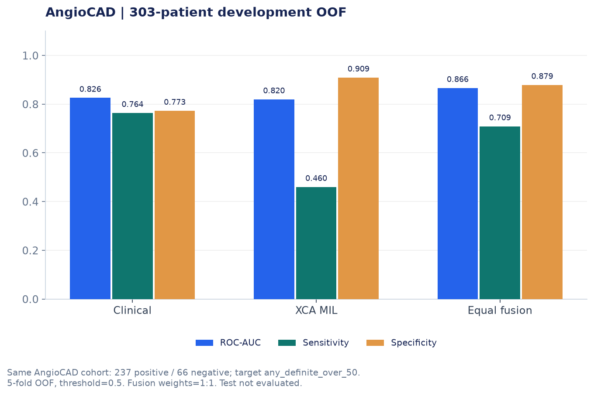

# AngioCAD | 실험 과정 및 모델 평가

관상동맥조영술(XCA) 영상을 이용해 데이터 전처리, 혈관 분할, 협착 분류, 임상정보와 영상의 Fusion 모델을 실험한 과정을 정리했습니다.

이번 실험에서는 다양한 모델을 적용하는 것뿐 아니라 **데이터의 특성과 평가 기준에 따라 모델의 성능이 어떻게 달라지는지**를 확인하는 데 중점을 두었습니다.

특히 혈관 분할의 Dice Score, 협착 분류의 AUROC, 환자 단위 Fusion의 Sensitivity는 각각 다른 의미를 갖기 때문에 평가 조건과 한계를 구분해 분석했습니다.

---

## 1. AngioCAD 데이터 분석과 전처리

### 1.1 데이터 구조 확인

모델 학습에 앞서 AngioCAD 데이터의 환자, Series, Frame, 협착 라벨 및 임상정보 연결 구조를 확인했습니다.

초기 데이터 확인에서는 영상 폴더 413개와 전체 121,566프레임을 점검했습니다.

이 과정에서 다음 항목을 확인했습니다.

- 비표준 영상 크기와 프레임 수의 차이
- 비정상적으로 짧거나 긴 Series
- 협착 라벨 범위의 역순 기록
- 영상과 임상정보의 연결 및 누락 여부
- 환자 간 중복 영상 가능성

환자 간 영상 중복 여부는 Pixel Hash를 이용해 검사했습니다.

데이터 전처리 이후에는 119,046프레임을 대상으로 영상 품질 확인 및 전처리 결과 점검을 진행했습니다.

다만 일부 품질 검사 항목은 저장된 결과와 설정값을 기반으로 확인한 것이므로, 모든 조건을 독립적으로 다시 검증한 것으로 해석하지 않았습니다.

### 1.2 환자 단위 데이터 분할

XCA 영상은 한 명의 환자에게 여러 Series와 Frame이 존재할 수 있습니다.

따라서 Frame 단위로 데이터를 무작위 분할하면 동일한 환자의 영상이 학습 데이터와 평가 데이터에 동시에 포함될 가능성이 있습니다.

이를 방지하기 위해 환자 단위로 데이터를 먼저 분리하고, 해당 환자의 Series 및 Frame에 동일한 분할 정보를 적용했습니다.

| 구분 | 환자 수 |
|---|---:|
| 영상 보유 환자 | 412명 |
| Development | 329명 |
| Test | 83명 |

Development 데이터에는 모델 평가를 위한 5-fold 분할 정보를 부여했습니다.

임상정보를 사용할 수 있는 환자는 별도로 확인했습니다.

| 구분 | Development | Test |
|---|---:|---:|
| 임상정보 사용 가능 환자 | 303명 | 73명 |

영상과 임상정보를 결합하는 Fusion 실험에서는 Development 환자 303명을 사용했습니다.

### 1.3 영상 전처리

영상의 명암 대비와 혈관 특징을 비교하기 위해 CLAHE 기반 전처리 방법을 구성했습니다.

- **원본 3채널 복제:** 원본 영상 값을 3개 채널에 동일하게 적용
- **원본 및 CLAHE 조합:** 서로 다른 대비 특성을 갖는 영상을 채널별로 조합
- **CLAHE 3채널 복제:** CLAHE 결과를 동일한 3개 채널로 구성

전처리 과정에서는 영상의 품질뿐 아니라 환자와 Series, Frame 간의 데이터 연결 관계가 유지되는지도 확인했습니다.

관련 코드:
- [AngioCAD 데이터 확인](../notebooks/01_AnigoCAD_데이터확인.ipynb)
- [영상 전처리](../notebooks/02_AngioCAD_전처리.ipynb)
- [환자 단위 데이터 분할](../notebooks/03_AngioCAD_환자단위_데이터분할.ipynb)

---

## 2. DCA1 기반 U-Net 혈관 분할

### 2.1 분할 모델 학습

혈관 분할 모델을 정량적으로 평가하기 위해 픽셀 단위 정답 마스크가 제공되는 DCA1 데이터셋을 사용했습니다.

134장의 영상과 정답 마스크를 이용해 U-Net 모델을 학습했습니다.

초기에는 작은 표본에 모델을 과적합시키는 방식으로 학습 코드와 정답 마스크 처리 과정이 정상적으로 동작하는지 확인했습니다.

이후 이미지 단위 5-fold OOF(Out-of-Fold) 평가를 진행했습니다.

DCA1에는 환자 ID가 제공되지 않아 환자 단위 데이터 분할을 보장할 수 없다는 한계가 있습니다.

### 2.2 U-Net 128 및 후처리 결과

| 방법 | Pooled Dice |
|---|---:|
| U-Net 128 Raw | 0.725928 |
| U-Net 128 + 16px 미만 연결 요소 제거 | 0.732256 |
| U-Net 128 + 32px 미만 연결 요소 제거 후보 | 0.732281 |
| Hough 기반 후처리 최고 후보 | 0.732002 |

기본 U-Net 128의 Raw Dice는 0.725928이었습니다.

작은 연결 요소를 제거하는 후처리를 적용했을 때 16px 기준의 Dice는 0.732256으로 증가했습니다.

32px 기준에서도 0.732281을 기록했지만, 해당 값을 최종적으로 사용한 16px 후처리 결과와 혼동하지 않도록 구분했습니다.

### 2.3 평균 성능 개선만으로 후처리를 선택하기 어려웠던 이유

작은 연결 요소를 제거하는 방식은 노이즈를 줄이는 데 도움이 됐지만, 일부 영상에서는 실제 혈관까지 함께 제거되는 문제가 있었습니다.

특히 카테터를 제거하기 위해 Hough Transform 기반 후처리를 시도했을 때, 특정 영상에서는 16px 후처리 대비 Dice가 약 0.1105 감소했습니다.

직선 형태의 구조물을 제거하는 과정에서 실제 혈관까지 손상될 가능성이 있었기 때문입니다.

따라서 Hough 기반 후처리는 채택하지 않았습니다.

이 과정에서 **전체 평균 Dice가 조금 높아졌다는 이유만으로 모든 영상에서 더 좋은 분할 결과를 얻었다고 판단할 수는 없다**는 점을 확인했습니다.

또한 후처리 정책을 동일한 OOF 결과를 살펴보며 선택했기 때문에, 해당 수치를 독립적인 Test 성능 개선으로 해석하지 않았습니다.

---

## 3. U-Net 입력 해상도 비교

U-Net 128과 함께 입력 크기를 256×256으로 확장한 U-Net 256도 학습했습니다.

### 3.1 성능 비교

| 모델 | 평가 기준 | Pooled Dice |
|---|---|---:|
| U-Net 128 | 128×128 GT | 0.725928 |
| U-Net 256 | 256×256 GT | 0.709043 |

U-Net 256은 초기 학습 과정에서 작은 표본에 대한 학습 확인 기준을 만족하지 못해 학습을 연장한 기록이 있습니다.

최종 OOF에서는 U-Net 128보다 낮은 Dice를 기록했습니다.

같은 영상 ID를 기준으로 비교한 이미지별 Macro Dice 차이는 다음과 같습니다.

| 항목 | 결과 |
|---|---:|
| Macro Dice 차이 (256 - 128) | -0.016275 |
| 95% 신뢰구간 | [-0.024094, -0.008740] |
| Win / Tie / Loss | 48 / 0 / 86 |

다만 두 모델은 각 해상도로 변환한 정답 마스크에서 평가했고, 학습 이력도 동일하지 않았습니다.

따라서 결과만으로 입력 해상도 하나가 성능 차이의 원인이라고 단정하기 어렵습니다.

**해상도를 높이는 것이 반드시 Dice 개선으로 이어지는 것은 아니었으며, 학습 조건과 평가 기준을 함께 고려해야 했습니다.**

관련 코드:
- [U-Net 128 혈관 분할](../notebooks/04_AngioCAD_DCA1_UNet_혈관분할.ipynb)
- [U-Net 256 실험](../notebooks/05_AngioCAD_DCA1_UNet256.ipynb)

---

## 4. AngioCAD 영상 적용과 MedicalSAM 비교

### 4.1 U-Net 모델의 AngioCAD 적용

DCA1에서 학습한 U-Net 128 모델 5개를 AngioCAD 영상에 적용했습니다.

적용 범위는 12개 Series, 36개 Frame입니다.

이 과정에서 모델 Checkpoint를 불러오는 구조를 조정하고, 기존 저장 결과와 비교해 추론 과정을 확인했습니다.

다만 AngioCAD에는 이 실험에 사용할 픽셀 단위 혈관 정답 마스크가 없었습니다.

따라서 AngioCAD에 적용한 분할 결과는 정성적으로만 검토했습니다.

**DCA1에서 측정한 Dice를 AngioCAD 데이터에 대한 분할 성능으로 사용하지 않았습니다.**

### 4.2 MedicalSAM3 Text Prompt 실험

사전학습된 MedicalSAM3를 이용해 Text Prompt 기반 혈관 분할을 진행했습니다.

`coronary artery`라는 고정 Prompt를 적용한 DCA1 평가 결과는 다음과 같습니다.

| 방법 | 평가 기준 | Dice |
|---|---|---:|
| MedicalSAM3 Text Prompt | 128×128 Pooled Dice | 0.256543 |
| MedicalSAM3 GT-box 진단 | Native 해상도 Macro Mean Dice | 0.710780 |

GT-box 진단은 정답 마스크에서 만든 Bounding Box를 모델에 제공한 실험입니다.

따라서 높은 Dice가 나왔더라도, 정답 위치 정보를 모르는 상태에서 자동으로 혈관을 찾아낸 성능과는 구분해야 합니다.

두 수치는 입력 Prompt와 평가 해상도, 집계 방식이 달라 직접적인 성능 비교로 해석하지 않았습니다.

[MedicalSAM3 Prompt 진단 결과](../figures/sam3_prompt_diagnostics.png)

### 4.3 멀티모달 모델을 이용한 Prompt 생성

MedicalSAM의 Text Prompt만으로 원하는 혈관을 구분하기 어려운 문제를 살펴보기 위해 GPT-4o와 Qwen2.5-VL을 이용한 Prompt 생성도 실험했습니다.

멀티모달 모델에서 혈관 이름과 위치 정보를 생성하고, 이를 분할 모델의 입력에 연결하는 방식입니다.

그러나 출력 형식이 정상적이라고 해서 해부학적으로 정확한 결과가 생성되는 것은 아니었습니다.

특히 Qwen 기반 LCX 사례에서는 서로 다른 혈관 이름인 LM과 LCX에 대해 생성된 마스크 간 Dice가 약 0.996으로 나타났습니다.

이 수치는 **정답 마스크와의 Dice가 아니라 두 Prompt의 출력 마스크가 얼마나 유사한지를 나타내는 값**입니다.

서로 다른 혈관을 지정했는데도 거의 동일한 영역이 생성될 수 있다는 점을 확인했으며, 정확한 해부학적 구분 여부는 추가적인 수동 평가가 필요합니다.

또한 Bounding Box와 Point의 형식이 올바르거나 모델 자체 검사를 통과한 것이 실제 혈관 위치의 정확성을 보장하지는 않았습니다.

### 4.4 MedSAM2 및 CA-SAM2 실험

MedSAM2 코드에 CA-SAM2 가중치를 연결해 단일 Frame의 Point 기반 분할을 진행했습니다.

가중치의 471개 Key가 일치하는지 확인하고 모델을 불러온 뒤, Positive Point를 이용한 분할 결과를 검토했습니다.

그러나 생성된 세 개의 후보 마스크 모두 지정한 Positive Point를 포함하지 않았습니다.

Point를 포함하는 후보가 없는 경우 가장 높은 모델 내부 점수의 후보를 선택하도록 구성돼 있었지만, 이 경우에도 지정한 위치가 실제로 포함됐다고 볼 수는 없습니다.

또한 모델 내부 점수 0.668은 정답 마스크와 비교한 Dice가 아닙니다.

따라서 해당 사례는 추론 자체는 진행했지만, 적절한 혈관 분할 결과를 확인한 것으로 판단하지 않았습니다.

Point가 포함되지 않는 원인과 후보 선택 방식은 추가 검토가 필요합니다.

관련 코드:
- [U-Net AngioCAD 적용](../notebooks/06_AngioCAD_UNet128_시각검증_.ipynb)
- [MedicalSAM3 혈관 분할](../notebooks/07_AngioCAD_MedicalSAM3_혈관분할_.ipynb)
- [Qwen 및 SAM3 Prompt 실험](../notebooks/08A_AngioCAD_MedicalSAM3_mLLM_LCX_실험.ipynb)
- [MedSAM2 / CA-SAM2](../notebooks/12_AngioCAD_MedSAM2_vessel_segmentation.ipynb)

---

## 5. ResNet 기반 협착 분류와 Grad-CAM

### 5.1 ResNet50 협착 등급 분류

혈관 분할 실험과 별도로, ResNet50을 이용해 관상동맥 15개 분절의 협착 등급을 분류했습니다.

초기에는 7등급 분류를 진행했고, 이후 라벨을 3개 구간으로 단순화하면서 학습 설정도 변경했습니다.

| 평가 지표 | 7등급 실험 | 3-bin 실험 |
|---|---:|---:|
| QWK | 0.352706 | 0.389810 |
| Balanced Accuracy | 0.273112 | 0.502628 |
| Over 50% AUROC | 0.819144 | 0.806758 |

이 실험에서 QWK와 Balanced Accuracy는 개선됐지만, 50% 초과 협착 여부를 구분하는 AUROC는 감소했습니다.

라벨 구성과 학습 조건이 함께 변경됐기 때문에 성능 차이를 특정 요인 하나의 효과로 해석하기는 어렵습니다.

해당 결과는 Validation 기준이며 최종 Test 결과는 확보하지 못했습니다.

초기 Validation은 66명의 환자에서 생성된 131개 Patient-View 및 980개 Patient-View-Artery 단위 평가를 포함합니다.

### 5.2 ResNet18 근위부 혈관 분류

추가로 ResNet18을 이용해 근위부 LCX와 LAD의 정상(NL) 및 이상(Abnormal) 여부를 분류했습니다.

이 실험은 앞선 ResNet50 분류와 다른 환자 단위 70/15/15 데이터 분할을 사용했습니다.

Test 환자 62명을 대상으로 환자별 평균 예측 확률을 평가한 결과입니다.

| 분류 대상 | Test ROC-AUC |
|---|---:|
| Prox LCX | 0.718954 |
| Prox LAD | 0.639254 |

[근위부 혈관 분류 결과](../figures/prox_classification.png)

해당 Test 실험에는 780개 Frame이 포함됐지만, 위 AUROC는 환자별 평균 확률을 이용해 평가한 값입니다.

따라서 ResNet50의 Validation 결과와 하나의 Test 성능처럼 합치지 않았습니다.

### 5.3 Grad-CAM 분석의 한계

Grad-CAM과 Threshold 기반 Pseudo-mask를 이용해 모델이 영상의 어느 영역에 반응하는지 살펴봤습니다.

하지만 Grad-CAM이 강조한 영역이 실제 협착 병변 위치와 일치하는지 평가할 수 있는 정답 정보는 확보하지 못했습니다.

따라서 시각화 결과를 협착 병변의 정확한 위치 탐지 성능으로 해석하지 않았습니다.

관련 코드:
- [ResNet50 협착 등급 분류](../notebooks/08_AngioCAD_협착등급_Classifier.ipynb)
- [ResNet18 근위부 분류 및 Grad-CAM](../notebooks/11_AngioCAD_classification_gradcam.ipynb)

---

## 6. Clinical AI와 XCA 모델의 Late Fusion

### 6.1 실험 구성

영상과 임상정보를 함께 사용할 때 관상동맥질환 관련 분류 성능이 어떻게 달라지는지 확인하기 위해 Late Fusion을 실험했습니다.

AngioCAD Development 데이터 중 임상정보와 영상을 모두 사용할 수 있는 303명을 대상으로 환자 단위 5-fold OOF 평가를 진행했습니다.

| 구분 | 모델 및 방법 |
|---|---|
| Clinical-only | AdaBoost 기반 임상정보 분류 |
| XCA-only | ResNet50 기반 Attention MIL |
| Late Fusion | 두 모델의 환자별 예측 확률을 1:1 평균 |
| Target | `any_definite_over_50` |
| Threshold | 0.5 |

Clinical-only 모델에서는 후보 변수 57개를 검토하고, Mutual Information 기반으로 25개 변수를 선정했습니다.

클래스 불균형을 고려한 Undersampling은 학습 데이터 내부에서 적용했습니다.

XCA 모델은 환자의 여러 Frame을 하나의 Bag으로 처리하는 Attention MIL 방식으로 구성했으며, 해당 실험에서 고정된 8 Epoch 학습 설정을 사용했습니다.

### 6.2 모델별 평가 결과

| 모델 | ROC-AUC | Sensitivity | Specificity | Accuracy |
|---|---:|---:|---:|---:|
| Clinical-only | 0.8257 | **0.7637** | 0.7727 | **0.7657** |
| XCA-only MIL | 0.8197 | 0.4599 | **0.9091** | 0.5578 |
| **Late Fusion** | **0.8662** | 0.7089 | 0.8788 | 0.7459 |

Late Fusion은 Clinical-only보다 ROC-AUC와 Specificity가 높았습니다.

그러나 Sensitivity는 0.7637에서 0.7089로 낮아졌고 Accuracy 역시 감소했습니다.

즉, 전체적인 판별 능력이 개선되더라도 질환이 있는 환자를 놓치는 비율까지 함께 개선된 것은 아니었습니다.

### 6.3 Paired Bootstrap 분석

동일한 303명 환자의 OOF 예측을 이용해 Clinical-only와 Late Fusion 사이의 성능 차이를 Paired Bootstrap으로 비교했습니다.

| 평가 항목 | Fusion - Clinical |
|---|---:|
| ROC-AUC 차이 | +0.0405 |
| ROC-AUC 95% CI | [+0.0169, +0.0657] |
| Sensitivity 차이 | -0.0549 |
| Sensitivity 95% CI | [-0.0928, -0.0169] |

이번 분석에서 Late Fusion의 AUROC는 증가했지만 Sensitivity는 감소했습니다.

이 결과를 통해 모델에 새로운 정보를 추가한다고 해서 모든 성능 지표가 개선되는 것은 아니라는 점을 확인했습니다.

특히 질환 선별을 목적으로 하는 경우에는 **AUROC가 높아졌더라도 False Negative 증가 가능성을 함께 고려해야 한다**고 생각했습니다.

Bootstrap 신뢰구간은 현재 개발 OOF 환자 표본에서의 성능 차이를 분석한 결과입니다.

모델 재학습, 모델 선택 과정이나 외부 환자 집단의 변동까지 반영한 독립 검증은 아닙니다.

관련 코드:
- [AngioCAD Clinical-only 실험](../notebooks/09_AngioCAD_clinical_only.ipynb)
- [XCA / Clinical Late Fusion](../notebooks/10_AngioCAD_XCA_Clinical_Fusion.ipynb)

---

## 7. 주요 문제와 개선 과정

### 7.1 평가 데이터 누수 방지

환자 한 명에게 여러 Series와 Frame이 존재하는 XCA 데이터 특성상, Frame 단위 무작위 분할은 동일 환자가 학습과 평가에 중복 포함될 가능성이 있습니다.

AngioCAD에서는 환자 단위로 데이터를 분할하고 Series 및 Frame에 동일한 분할을 적용해 이러한 문제를 방지하고자 했습니다.

### 7.2 평균 Dice와 개별 영상의 차이

U-Net 후처리에서 평균 Dice가 개선되더라도 특정 혈관 영역이 함께 제거되는 경우가 있었습니다.

따라서 후처리를 평가할 때는 전체 평균뿐 아니라 개별 영상에서의 성능 변화와 혈관 구조 보존 여부를 함께 확인할 필요가 있었습니다.

### 7.3 Prompt 기반 분할의 정확성

MedicalSAM과 멀티모달 모델 실험에서는 정상적인 Prompt 또는 JSON 응답이 생성되더라도 실제 혈관을 정확히 구분하지 못하는 사례가 있었습니다.

형식 검사나 모델 내부 점수는 해부학적 정답 평가를 대신할 수 없었습니다.

추가적인 정답 데이터와 수동 평가가 필요합니다.

### 7.4 협착 분류와 위치 탐지의 차이

협착 등급을 분류하는 모델의 AUROC가 높다고 해서 병변 위치까지 정확히 찾아냈다고 볼 수는 없습니다.

Grad-CAM은 모델이 참고한 영역을 분석하는 수단이며, 병변 위치의 정확성을 검증하려면 별도의 위치 정답 데이터가 필요합니다.

### 7.5 Fusion에서 나타난 성능의 상충 관계

Late Fusion은 AUROC와 Specificity를 개선했지만 Sensitivity와 Accuracy는 낮아졌습니다.

CAD 선별을 목적으로 할 때는 환자를 놓치지 않는 것이 중요한 만큼, 모델 결합의 효과를 하나의 평가 지표로만 판단하기 어렵다는 점을 확인했습니다.

---

## 8. 실험 완료 범위와 향후 개선 방향

| 작업 | 현재 상태 |
|---|---|
| AngioCAD 데이터 분석 및 전처리 | 수행 |
| 환자 단위 Development / Test 분할 | 완료 |
| DCA1 U-Net 128 / 256 분할 비교 | 내부 평가 완료 |
| U-Net 후처리 성능 비교 | 내부 평가 완료 |
| U-Net의 AngioCAD 적용 | 정성적 확인 |
| MedicalSAM3 Text Prompt 실험 | DCA1 내부 평가 완료 |
| Qwen / GPT 기반 Prompt 연결 | 일부 사례 실험 |
| MedSAM2 / CA-SAM2 분할 | 단일 사례 추론, 정확성 미확인 |
| ResNet50 협착 등급 분류 | Validation 평가 완료 |
| ResNet18 근위부 혈관 분류 | 별도 Test 평가 완료 |
| Clinical / XCA Late Fusion | 개발 데이터 OOF 평가 완료 |
| AngioCAD 분할 정답 기반 평가 | 미완료 |
| MedicalSAM 결과의 다환자 수동 평가 | 미완료 |
| Fusion의 독립 Test 및 외부 검증 | 미완료 |

### 향후 개선 방향

추후에는 다음 작업을 진행할 필요가 있습니다.

- AngioCAD 영상의 혈관 분할 정답 확보 및 정량 평가
- MedicalSAM과 멀티모달 Prompt 결과의 다환자 검증
- Prompt 입력 Series 및 결과 저장 경로 불일치 원인 확인
- MedSAM2의 Positive Point 미포함 문제 분석
- 협착 분류 및 Fusion 모델의 독립 Test 평가
- 외부 데이터 검증과 선별 목적에 맞는 Threshold 검토

현재 결과는 각 데이터셋에서 진행한 내부 평가와 일부 정성 분석을 중심으로 한 것으로, 임상 적용 성능을 입증한 결과는 아닙니다.

---

## 9. 실험을 통해 배운 점

이번 프로젝트에서 가장 중요하게 느낀 점은 **모델의 출력이 정상적으로 생성되는 것과 실제로 정확한 예측을 수행하는 것은 다른 문제**라는 것입니다.

혈관 분할에서는 높은 평균 Dice를 얻더라도 일부 혈관이 제거될 수 있었고, MedicalSAM에서는 정상적으로 마스크가 생성되더라도 원하는 혈관이 아닐 수 있었습니다.

또한 협착 분류 결과를 Grad-CAM으로 시각화했다고 해서 병변 위치를 정확하게 탐지한 것으로 볼 수는 없었습니다.

Fusion 실험에서도 두 종류의 데이터를 결합했을 때 AUROC는 증가했지만 Sensitivity는 감소했습니다.

이러한 과정을 통해 단순히 모델의 성능 수치를 높이는 것보다 **데이터 구조, 정답 정보, 평가 방식, 실제 사용 목적을 함께 고려하는 것이 중요하다**는 점을 배웠습니다.

앞으로는 새로운 모델과 방법을 적용할 때도 평균 성능뿐 아니라 개별 사례의 실패 원인과 평가 과정의 한계를 함께 확인하고자 합니다.

---

### 관련 문서

- [프로젝트 소개](../README.md)
- [평가 결과 및 성능 지표](../results/README.md)
- [데이터 및 모델 출처](data_sources.md)
- [실험 환경](environment.md)

각 실험의 세부 코드는 `notebooks/`에서 확인할 수 있습니다. 모델별 평가 수치는 기존 실험 기록을 바탕으로 정리했으며, 전체 노트북의 재학습 및 외부 검증은 별도로 진행하지 않았습니다.
